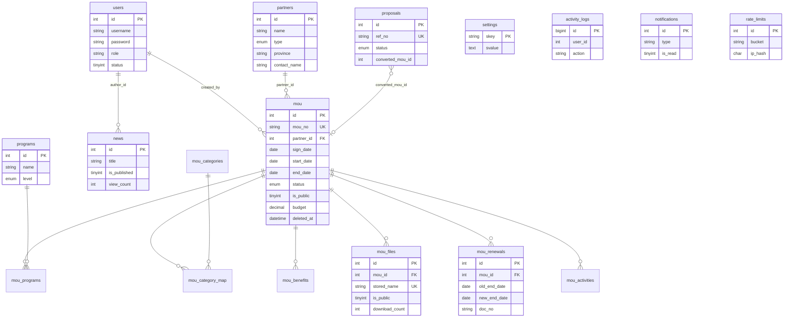

# โครงสร้างโฟลเดอร์

```
mou-system/
├── .htaccess                 URL สวย (/mou/5, /news/3, /contact, /download/7)
├── index.php                 (ส่วนที่ 2) จุดเข้าหน้าแรก
├── config/
│   └── config.php            ค่าตั้งค่า DB, BASE_URL, ความปลอดภัย, อัปโหลด
├── includes/
│   ├── db.php                PDO + db_all/db_one/db_val/db_exec/db_insert
│   ├── functions.php         escape, วันที่ พ.ศ., CSRF, flash, settings, สถานะ MOU,
│   │                         rate limit, อัปโหลดไฟล์, activity log
│   ├── auth.php              session, login/logout, role & permission
│   ├── header_public.php     (ส่วนที่ 2) layout หน้าสาธารณะ
│   └── header_admin.php      (ส่วนที่ 3) layout หลังบ้าน + sidebar
├── models/                   (ส่วนที่ 2-3) คลาส/ฟังก์ชันคิวรีของ MOU, Partner, News ฯลฯ
├── public/                   หน้าสาธารณะ: index, mou_list, mou_detail, news_*, contact, download
├── admin/                    หลังบ้าน: login, dashboard, mou_*, partners, programs,
│                             news, proposals, reports, users, logs
├── assets/{css,js,img}/
├── uploads/                  ไฟล์อัปโหลด (ห้ามเข้าตรง) mou/ proposals/ news/ activities/ logos/
└── database/schema.sql       ตาราง + ข้อมูลตัวอย่าง 12 MOU + ผู้ใช้เริ่มต้น
```

# ERD



ตารางที่เพิ่มจากที่กำหนด: `notifications` (แจ้งเตือนหลังบ้าน) และ `rate_limits` (จำกัดอัตราส่งฟอร์ม/login ใช้ฐานข้อมูลเพื่อให้ทำงานบน shared hosting ได้)

# สิทธิ์ผู้ใช้

| บทบาท | สิทธิ์ |
|---|---|
| admin | ทุกอย่าง รวมผู้ใช้ ตั้งค่า log |
| staff | MOU, ต่ออายุ, หน่วยงาน, สาขา, ข่าว, ข้อเสนอ, รายงาน, dashboard |
| viewer | dashboard และรายงานอย่างเดียว |

# ติดตั้งเบื้องต้น (XAMPP)

1. คัดลอกโฟลเดอร์ `mou-system` ไปที่ `C:\xampp\htdocs\`
2. เปิด Apache + MySQL ใน XAMPP Control Panel; เปิด `mod_rewrite` (ค่าเริ่มต้นเปิดอยู่)
3. เปิด phpMyAdmin → Import → เลือก `database/schema.sql` (สร้างฐาน `mou_bangna` ให้เอง)
4. แก้ `config/config.php`: `DB_USER/DB_PASS`, `BASE_URL`, `RATE_SALT`
5. ถ้าไม่ได้วางที่ `/mou-system` ให้แก้ `RewriteBase` ใน `.htaccess`
6. เข้าหลังบ้าน `BASE_URL/admin/login.php` → `admin` / `Admin@1234` แล้วเปลี่ยนรหัสผ่านทันที
7. ขึ้น production: ตั้ง `APP_ENV` เป็น `production`, ตั้งรหัสผ่าน DB, ใช้ HTTPS

บัญชีทดสอบ: `staff01` / `Staff@1234`, `viewer01` / `Viewer@1234` (ลบก่อนใช้งานจริง)
